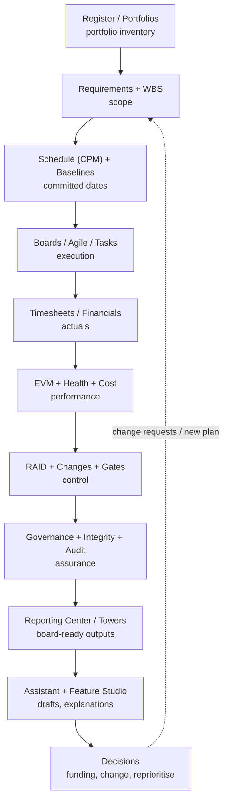
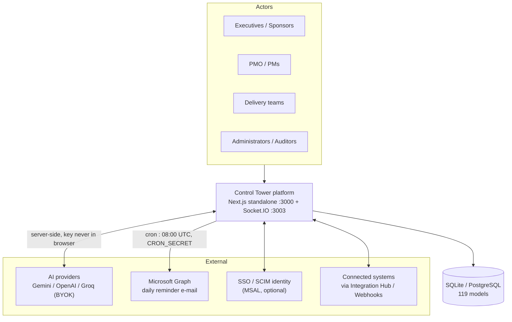
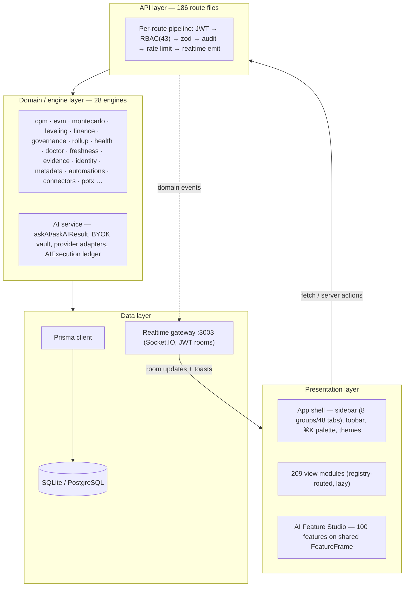
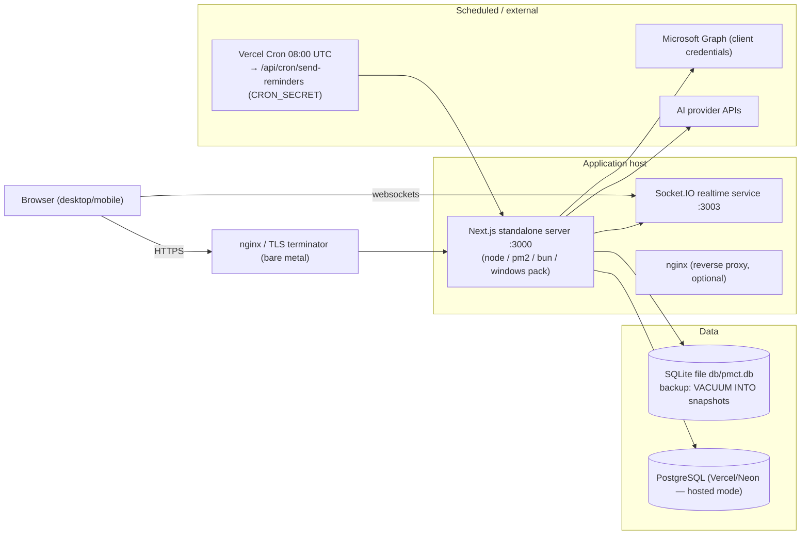
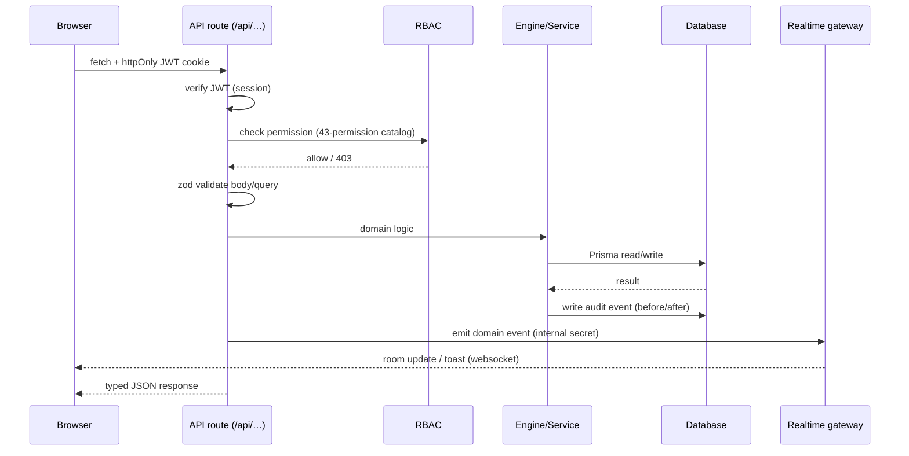
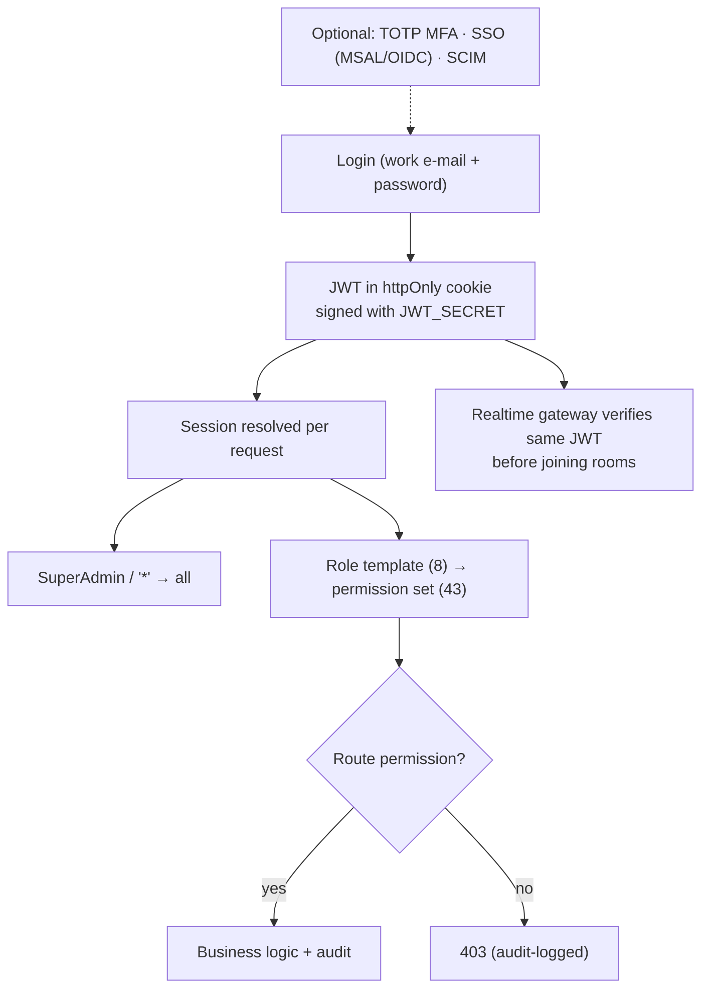
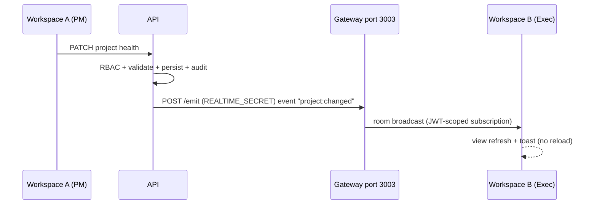
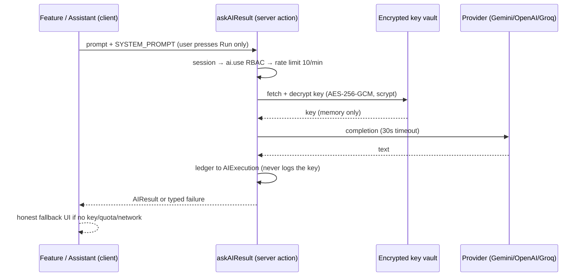
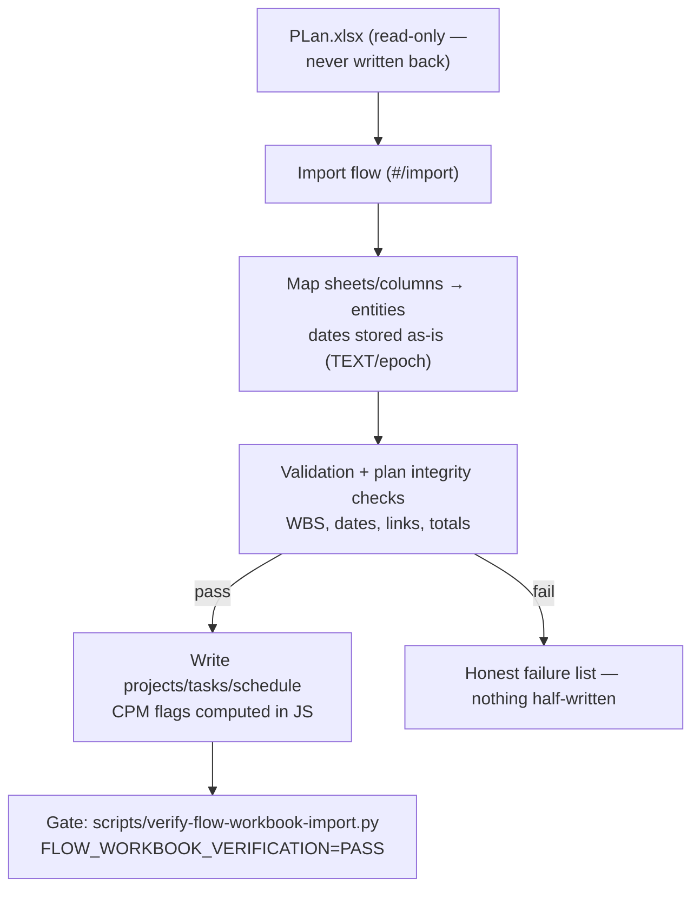
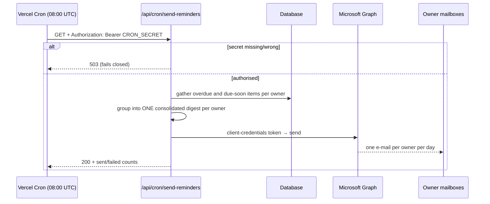

# Control Tower — Enterprise User Manual

**PM Control Tower (Control Tower) · Platform version 3.1.0 · October 2026**

**Audience:** executive sponsors, PMO leaders, administrators, project managers and delivery teams.

**Status:** authoritative consolidation. Cross-references the numbered document suite (01–13) and
specialist guides (AI-BYOK, FLOW import, EMAIL-REMINDERS, ANALYTICS, BUSINESS-PLAN).

| | |
|---|---|
| Platform | Control Tower — Enterprise Project, Program & Portfolio Management |
| Brand lockup | Optinus Solutions × Czarnikow (header); login shows "Control Tower" |
| Runtime | Node ≥ 20.9 (Next.js standalone, Bun optional), Socket.IO realtime gateway |
| Data | SQLite (default) or PostgreSQL (Vercel/hosted deployments), Prisma schema |
| Scale in repo | 119 data models · 186 API route files · 209 view modules · 28 computation engines · 43 permissions · 8 role templates · 48 sidebar tabs · 100 AI features · 143 automated tests |

**How to read this manual.** Sections 1–4 tell you *what you get and how the work flows*.
Section 5 is the architecture with diagrams. Sections 6–7 are the business case and cost.
Section 8 is setup, end to end. Statements marked **[E]** are estimates/assumptions, **[R]** are
planning ranges, **[V]** are verified vendor/market figures (sourced in the business plan).

---

## Table of contents

1. [Benefits — what the platform delivers](#1-benefits--what-the-platform-delivers)
2. [Feature catalogue — every capability](#2-feature-catalogue--every-capability)
3. [Tab linkage — every tab to its outcome](#3-tab-linkage--every-tab-to-its-outcome)
4. [End-to-end working design](#4-end-to-end-working-design)
5. [Architecture and diagrams](#5-architecture-and-diagrams)
6. [Business case](#6-business-case)
7. [Cost](#7-cost)
8. [Setup — installation to go-live](#8-setup--installation-to-go-live)
9. [Security, governance and operations](#9-security-governance-and-operations)
10. [Glossary and document index](#10-glossary-and-document-index)

---

## 1. Benefits — what the platform delivers

**One platform, one truth.** Control Tower replaces the fragmented stack (spreadsheet plans +
task tool + BI extracts + slide-deck assembly) with a single system where the plan, the actuals,
the money and the reporting come from the same database — so the number on the executive slide
is the same number in the task list.

### 1.1 Benefits by stakeholder

| Persona | Primary benefit | Evidence in the product |
|---|---|---|
| **Executive / Sponsor** | Real-time portfolio truth without waiting for a monthly pack; faster, better-grounded decisions | Executive Control Tower, Leadership Control Tower (20 tabs in 4 groups), Investment & Business Case (NPV/IRR/payback), EVM, alerting |
| **PMO leader** | Standardised way of working across all projects; automated status production; defensible governance | Reporting Center (library, builder, board packs, scheduled runs, subscriptions), Stage Gates, Governance, Data Integrity, 70 PMO templates |
| **Project manager** | One workspace from charter to closure — scope, schedule, cost, risk, change, status — with AI drafting the first 80% | Project Register → WBS → Schedule (CPM/Gantt/baselines) → EVM/Health/RAID/Changes, AI PM Assistant, 100-feature AI Feature Studio |
| **Delivery team** | Clear personal work surface; no tool-hopping | Boards (Kanban/Calendar/Workload), Tasks, Agile Delivery (sprints), Work Inbox, Focus Planner, Timesheets |
| **Finance controller** | Actuals that tie to the plan; forecast discipline; billing control | Financials, EVM (CPI/SPI/EAC/ETC/VAC), Clients & Billing, Expenses, Investment cases |
| **Field / site teams** | Site reality flows into the same project record | Field Operations (RFIs, daily logs, punch lists), Proofing & Approvals |
| **Compliance / Auditor** | Immutable trail, permission boundaries, evidence on demand | Audit log, RBAC (43 permissions), Integrity (freshness, evidence bundles, doctor checks) |
| **IT / Security** | Self-hosted control, no vendor lock-in, BYOK AI, standard stack | Docker/PM2/Bun/Windows-pack deployments, SQLite/Postgres, JWT + TOTP + SCIM + SSO (MSAL), encrypted AI key vault |

### 1.2 Platform-level benefits

1. **Single source of truth** — 119 models on one core; every tab reads and writes the same
   records. No reconciliation between a scheduling tool, a task tool and a BI extract.
2. **Effort replacement, not just tool replacement** — status production, pack assembly and
   roll-ups are computed (engines) and rendered (Reporting Center, PPT export of 42 views)
   instead of being hand-built. The business case models this as the dominant cost line
   (PMO reporting effort: status-quo ~$480k/3yr at 100 users vs ~$60k with Control Tower) **[E]**.
3. **Deterministic calculation, AI for narrative** — CPM, EVM, Monte Carlo, PERT, finance and
   leveling are computed in code; the AI layer only narrates numbers the client computed and
   is forbidden (system prompt, enforced) from inventing metrics.
4. **Bring-your-own-key AI at zero licence cost** — one provider key (Gemini default, OpenAI/Groq
   swappable) powers the assistant and all 100 features; no per-seat AI add-on, no subscription
   inside the platform, key encrypted server-side and never exposed to the browser.
5. **Governance by construction** — RBAC on every API (43 permissions, 8 role templates), audit
   events on mutations, rate limiting, stage gates, change control and a data-integrity layer
   (freshness, evidence, doctor) make answers defensible in an audit.
6. **Deployment freedom** — Docker Compose, bare metal (PM2/nginx), Bun, a one-click Windows
   pack, or Vercel + Postgres. Data stays where you put it.
7. **Automation of the routine** — Control Automations, webhooks, integrations and the daily
   consolidated e-mail reminder (Microsoft Graph) keep work moving without a human chasing.

---

## 2. Feature catalogue — every capability

### 2.1 Portfolio & project core (Plan)
- **Project Register** — portfolio inventory with codes, health, owners, dates, budget.
- **Requirements** — requirement backlog with status and traceability to delivery.
- **WBS** — hierarchical work breakdown (drag-and-drop tree) that feeds schedule and cost.
- **Tasks** — cross-project task list with effort, assignees, due dates, status, priority.
- **Agile Delivery** — epics, sprints (one active per project), story points, backlog grooming,
  sprint board with drag-and-drop and server-recomputed committed points.
- **Schedule** — CPM engine (dependencies, constraints, lag), Gantt with today marker, critical
  path, progress fills and milestone diamonds; **Milestones** and **Baselines** snapshots for
  variance; **Planning Lab** for what-if/estimate tooling (PERT, Monte Carlo).
- **Portfolios / Programs / Projects** — three-level hierarchy with roll-up of health, budget
  and schedule across levels.

### 2.2 Execution (Execute)
- **Boards (omni views)** — the same tasks as Kanban (status lanes), Calendar (month grid,
  weekends shaded) and Workload (resource × week heatmap, 4–26 weeks, over-allocation red).
- **Resources** — resource register (avatars seeded from employee code), assignments,
  capacity vs demand.
- **Timesheets** — own time entry with draft/submit workflow, approval queue, actuals feeding
  cost and EVM.
- **Work Inbox** — personal triage of assigned actions, approvals and alerts.
- **Focus Planner** — personal timeboxing of the work that matters this week.

### 2.3 Control & finance (Control)
- **Financials** — budgets, costs, commitments per project/program.
- **Clients & Billing** — clients, invoices (server-computed totals, paid-invoice lock), expenses.
- **Investment & Business Case** — cases with NPV, IRR, payback, sensitivity (finance engine).
- **EVM** — PV/EV/AC, SPI/CPI, EAC/ETC/VAC with configurable alert thresholds.
- **Health** — composite health scoring and trend.
- **RAID** — risks, issues, assumptions, decisions with owners, severity, mitigation tracking.
- **Change Control** — change requests with impact and decision trail.
- **Stage Gates** — gate definitions, evidence, go/no-go decisions per phase.
- **Governance** — governance controls and compliance view for the PMO framework.
- **Data Integrity** — freshness signals, evidence bundles, doctor checks (orphans, deadline
  breaches, unassigned effort) so numbers can be trusted.
- **Prioritization** — weighted scoring / optimizer to rank competing investments.
- **CTO Tower** — technology/estate oversight view.
- **Field Operations** — RFIs (auto-numbered, aging), daily logs, punch lists, BIM iframe.

### 2.4 Strategy & knowledge
- **Feedback & Roadmap** — feedback posts with votes, triage into roadmap lanes.
- **Docs & Knowledge** — spaces, pages, markdown editor (institutional memory).
- **Message Boards** — threaded discussions, replies, pins (decision record).
- **Proofing & Approvals** — review rounds with annotations and approval decisions.

### 2.5 Intelligence
- **Executive Control Tower** — live KPIs, RAG donut, investment view, top risks, alerts,
  capacity, EVM bars, hours trend, governance queue.
- **Leadership Control Tower** — 20-tab executive/PMO pack in 4 groups.
- **Reports** — report suite across the portfolio.
- **Reporting Center** — sections: Library · My Reports · Report Builder · Board Packs ·
  Scheduled · Subscriptions · History (template library documented at 177 report templates).
- **Analytics** and **PMO Analytics (Insights)** — trends, distributions, insights reports.
- **AI PM Assistant** — conversational drafting grounded in live register data.
- **AI Feature Studio** — 100 ranked features (f001–f100) across 10 categories, each a
  one-button draft generator with client-computed arithmetic (EVM, PERT, EAC/ETC/VAC, phasing,
  cash-flow, velocity, ratios) and an honest fallback when the AI key/quota/network is missing.
- **Export** — universal PowerPoint export: any of 42 views as a native 16:9 deck.

### 2.6 Connect
- **Integration Hub** — connector catalog to external systems.
- **Control Automations** — event/rule automations (e.g. overdue escalation).
- **Notifications** — in-app notification centre and preferences.
- **Webhooks** — outbound HTTP hooks on platform events.
- **AI Connector Gateway** — central AI provider routing/status.
- **Extension Hub** — optional capability extensions.

### 2.7 Administration
- **Users** (activate/deactivate, role change, activity), **Roles** (8 templates + custom,
  43-permission matrix), **Templates** (70 PMO project templates, apply-to-new-project),
  **Audit** (server-side filtered event log with before/after JSON), **Settings** (env readiness,
  AI provider BYOK card, probes, entity counts), **Fields** (custom-field dictionary),
  **Tabs** (tab builder), **SCIM/SSO** identity integration.

### 2.8 Platform engines (`src/lib/engines/` — 28)
`cpm` (critical path) · `evm` · `montecarlo` · `leveling` (resource) · `calendars` (working-day
index) · `finance` (NPV/IRR/payback) · `prioritization` · `scenario` · `rollup` ·
`executive-portfolio` · `leadership` · `steering` · `health` · `governance` · `benefits` ·
`doctor` (data health) · `freshness` · `evidence` · `identity` (TOTP/SCIM) · `metadata`
(custom fields) · `custom-fields` · `automations` · `connectors` · `timesheet` · `calibration` ·
`pptx` + `pptx-views` (export) · `zip`.

---

## 3. Tab linkage — every tab to its outcome

The sidebar has **8 groups and 48 tabs**. Each row links: **tab → route → what you do → the
immediate outcome/artifact → the permission required**. Section 4.3 shows how the outcomes chain
end to end.

### 3.1 Executive

| Tab | Route | What you do there | Outcome / artifact | Permission |
|---|---|---|---|---|
| Executive Control Tower | `#/dashboard` | Read live KPIs, RAG, investment, risks, alerts, capacity, EVM, governance queue | Instant portfolio situational awareness; alert-driven interventions | `executive.view` |

### 3.2 Plan

| Tab | Route | What you do there | Outcome / artifact | Permission |
|---|---|---|---|---|
| Project Register | `#/register` | Create/curate projects, codes, owners, budgets, dates | The portfolio inventory every other tab keys from | `project.view` |
| Requirements | `#/requirements` | Capture and status requirements | Scope baseline with traceability | `project.view` |
| WBS | `#/wbs` | Build the work breakdown tree | Scope structure feeding schedule & cost | `project.view` |
| Tasks | `#/tasks` | Manage work items, owners, effort, dates | Execution backlog and actuals source | `project.view` |
| Agile Delivery | `#/agile` | Run epics/sprints/backlog, point story cards | Sprint execution and velocity history | `project.view` |
| Schedule | `#/schedule` | Build CPM schedule, Gantt, critical path | Committed dates, critical path, slippage signal | `project.view` |
| Milestones | `#/milestones` | Plan key dates | Milestone plan feeding gates and exec view | `project.view` |
| Baselines | `#/baselines` | Freeze a schedule snapshot | Variance reference (plan vs actual) | `project.view` |
| Planning Lab | `#/tools` | Run what-if / estimate tools (PERT, Monte Carlo) | Estimate confidence ranges for commitments | `project.view` |

### 3.3 Portfolio

| Tab | Route | What you do there | Outcome / artifact | Permission |
|---|---|---|---|---|
| Portfolios | `#/portfolios` | Group projects into portfolios, watch roll-ups | Investment container + aggregate health | `portfolio.view` |
| Programs | `#/programs` | Manage program-level structure and roll-up | Programme oversight and dependency view | `program.view` |
| Projects | `#/projects` | Open the full project workspace (tabs per project) | The project's single operating picture | `project.view` |

### 3.4 Execute

| Tab | Route | What you do there | Outcome / artifact | Permission |
|---|---|---|---|---|
| Boards | `#/boards` | Move work across Kanban / Calendar / Workload views | Flow control, over-allocation spotted early | `project.view` |
| Resources | `#/resources` | Maintain the resource register and assignments | Capacity vs demand picture (avatars, codes) | `resource.view` |
| Timesheets | `#/timesheets` | Log and approve time | Actuals that drive cost and EVM | `timesheet.own` (+`timesheet.approve`) |
| Work Inbox | `#/inbox` | Triage assigned actions and approvals | Zero-miss personal throughput | `inbox.use` |
| Focus Planner | `#/planner` | Timebox the week | A realistic personal delivery plan | `inbox.use` |

### 3.5 Control

| Tab | Route | What you do there | Outcome / artifact | Permission |
|---|---|---|---|---|
| Financials | `#/financials` | Track budget/cost/commitments | Cost baseline and spend visibility | `financial.view` |
| Clients & Billing | `#/clients` | Manage clients, invoices, expenses | Revenue control and billing evidence | `financial.view` |
| Field Operations | `#/field` | RFIs, daily logs, punch lists, BIM | Site-to-office data loop | `project.view` |
| Investment & Business Case | `#/investment` | Build cases with NPV/IRR/payback | Fund-or-kill evidence | `financial.view` |
| EVM | `#/evm` | Read SPI/CPI/EAC/ETC/VAC | Objective performance measurement | `evm.view` |
| Health | `#/health` | Review composite health/trend | Early-warning indicator set | `evm.view` |
| RAID | `#/raid` | Maintain risks, issues, assumptions, decisions | Exposure register with mitigations | `project.view` |
| Change Control | `#/changes` | Raise and decide change requests | Scope/decision audit trail | `project.view` |
| Stage Gates | `#/gates` | Run gate reviews with evidence | Go/no-go decisions per phase | `project.view` |
| Governance | `#/governance` | Apply governance controls and review compliance | Compliance posture for the PMO framework | `project.view` |
| Data Integrity | `#/integrity` | Freshness, evidence bundles, doctor checks | Trust layer: "can I defend this number?" | `integrity.view` |
| CTO Tower | `#/technology` | Technology/estate oversight | Technology risk and investment view | `integration.view` |
| Prioritization | `#/prioritization` | Score and optimise competing initiatives | Ranked, defensible investment order | `portfolio.view` |

### 3.6 Strategy & Knowledge

| Tab | Route | What you do there | Outcome / artifact | Permission |
|---|---|---|---|---|
| Feedback & Roadmap | `#/feedback` | Capture/vote feedback, triage to roadmap | Demand-driven product/delivery direction | `inbox.use` |
| Docs & Knowledge | `#/docs` | Author and organise knowledge pages | Institutional memory | `docs.use` |
| Message Boards | `#/boards-hub` | Discuss and pin threads | Durable decision record | `boards.use` |
| Proofing & Approvals | `#/proofing` | Review rounds with annotations, decide | Sign-off evidence on deliverables | `project.view` |

### 3.7 Intelligence

| Tab | Route | What you do there | Outcome / artifact | Permission |
|---|---|---|---|---|
| Leadership Control Tower | `#/reports/leadership` | Read the 20-tab, 4-group leadership pack | Board-ready leadership reporting | `reports.view` |
| Reports | `#/reports` | Run the report suite | Standard analytical outputs | `reports.view` |
| Reporting Center | `#/reporting` | Library, builder, board packs, schedules, subscriptions | Recurring, self-service reporting (no analyst queue) | `reports.view` |
| Analytics | `#/analytics` | Explore trends and distributions | Insight charts for decisions | `reports.view` |
| PMO Analytics | `#/insights` | PMO insights hub and insights reports | Programme/portfolio diagnostics | `reports.view` |
| AI PM Assistant | `#/assistant` | Ask for drafts grounded in live data | First-draft status/briefs in seconds | `ai.use` |
| AI Feature Studio | `#/ai-features` | Trigger any of 100 ranked AI features | Domain drafts (status, risk, cost, agile…) with computed facts | `ai.use` |

### 3.8 Connect

| Tab | Route | What you do there | Outcome / artifact | Permission |
|---|---|---|---|---|
| Integration Hub | `#/integrations` | Configure connectors | Systems kept in sync | `integration.view` |
| Control Automations | `#/automations` | Define event rules (e.g. overdue escalation) | Work that happens without chasing | `integration.view` |
| Notifications | `#/notifications` | Preferences and notification history | Awareness without inbox noise | `inbox.use` |
| Webhooks | `#/webhooks` | Outbound event endpoints | Downstream system triggers | `integration.view` |
| AI Connector Gateway | `#/ai-gateway` | AI provider routing/status | Central AI infrastructure control | `integration.view` |
| Extension Hub | `#/extensions` | Enable optional extensions | Capability added without a release | `integration.view` |

### 3.9 Administration (header → Settings / admin routes)

| Area | Route | Outcome | Permission |
|---|---|---|---|
| Admin Center | `#/admin-center` | Administration landing | `admin.users` etc. |
| Users | `#/admin/users` | People on/offboarded, roles assigned | `admin.users` |
| Roles | `#/admin/roles` | Permission matrix realised per role | `admin.users` |
| Templates | `#/admin/templates` | New projects born standardised (70 templates) | `admin.templates` |
| Audit | `#/admin/audit` | Who changed what, when, with before/after | `admin.audit` |
| Settings | `#/admin/settings` | Env readiness, AI key (BYOK), probes, branding | `admin.config` |
| Custom fields | `#/admin/fields` | Metadata dictionary (schema without code changes) | `admin.config` |
| Tab builder | `#/admin/tabs` | Workspace composition per need | `admin.config` |

---

## 4. End-to-end working design

### 4.1 The operating loop

Control Tower encodes one management loop, and every tab belongs to a stage of it:

```
   CAPTURE                PLAN                    EXECUTE                MEASURE                 GOVERN                  DECIDE
┌─────────────┐      ┌──────────────┐        ┌──────────────┐        ┌──────────────┐        ┌──────────────┐       ┌──────────────┐
│ Register     │ ───► │ Requirements │ ─────► │ Boards/Tasks │ ─────► │ Timesheets   │ ─────► │ RAID/Changes │ ─────►│ Exec/Leadership│
│ Feedback     │      │ WBS          │        │ Agile/Sprint │        │ EVM/Health   │        │ Gates        │       │ Tower          │
│ Field RFIs   │      │ Schedule     │        │ Inbox/Planner│        │ Cost/Billing │        │ Governance   │       │ Investment     │
└─────────────┘      │ Baselines    │        │ Resources    │        │ Integrity    │        │ Audit        │       │ Prioritization │
                      └──────────────┘        └──────────────┘        └──────────────┘        └──────────────┘       └──────┬───────┘
                             ▲                                         │                        ▲                      │
                             └───────────── change requests ───────────┘                        └──── decisions ──────┘
```

**Data lifecycle:** a project created in the Register fans out to WBS → Schedule (CPM) →
Baselines; execution writes Tasks/Sprints/Timesheets; the engines compute EVM, health, cost and
roll-ups; the integrity layer marks freshness and evidence; Reporting Center and the AI layer
render it; decisions flow back as changes, gate outcomes and reprioritisation.

### 4.2 Personas in the loop (day-in-the-life)

1. **Team member (morning)** → Work Inbox shows 3 assigned actions → Focus Planner timeboxes
   2 → moves a Kanban card → logs 6.5h in Timesheets (draft → submit).
2. **PM (daily)** → Register/Workspace update → Schedule recalculates critical path → RAID
   updated → Board reflects flow → Automations flag an overdue milestone → AI Feature Studio
   drafts the weekly status (f001) from computed facts → sends via Reporting Center schedule.
3. **PMO (weekly)** → Leadership pack refreshed → Data Integrity doctor run → governance queue
   cleared → Reporting Center board pack exported (PPT) → subscriptions delivered by e-mail.
4. **Executive (monthly)** → Executive + Leadership towers → drill to Investment/EVM →
   Prioritization re-ranks → gate decisions recorded → audit trail complete.

### 4.3 How the tabs chain (linkage end to end)



### 4.4 System working design (runtime behaviour)

1. **Authentication** — login issues a JWT held in an httpOnly cookie; the same secret material
   authenticates the realtime gateway (`REALTIME_SECRET_KEY = JWT_SECRET`). Optional TOTP MFA,
   SSO via MSAL (OIDC/Azure AD), SCIM provisioning.
2. **Routing** — hash router (`#/segment/sub`); `registry.tsx` maps segment → view component;
   the shell composes sidebar + topbar + command palette (⌘K). Role-aware home route redirects
   users without `executive.view` to the first workspace they can use.
3. **API pipeline** — every `/api/**` route runs: session/JWT → RBAC permission check → zod
   validation → business logic (engines/services) → audit event → rate limit → realtime emit →
   typed JSON response.
4. **Engines** — deterministic computation (CPM, EVM, Monte Carlo, finance, roll-up, leveling…)
   runs server-side in TypeScript; tests assert the maths (143-test suite).
5. **Realtime** — API publishes domain events (`project:changed`, `audit:created`, …) to the
   Socket.IO gateway (`:3003`) via an internal emit call; the browser subscribes to rooms and
   updates views + toast notifications without reload.
6. **AI** — client calls `askAIResult` (a "use server" action): session → `ai.use` RBAC →
   rate-limit (10/min) → decrypt BYOK key from the encrypted vault → provider adapter
   (Gemini/OpenAI/Groq, 30s timeout) → ledger entry in `AIExecution`. It never throws: failures
   return a typed status and an honest fallback string shown in the UI.
7. **Persistence** — Prisma over SQLite (absolute `DATABASE_URL`) or PostgreSQL on hosted
   deployments; additive `db push` schema sync (no migration history), reference data via seeds.

---

## 5. Architecture and diagrams

### 5.1 System context



### 5.2 Layered architecture



### 5.3 Deployment topology



**Deployment modes** (details: `docs/01-DEPLOYMENT-GUIDE.md`): A Docker Compose (recommended) ·
B bare metal (Node 20 + PM2 + nginx) · C Bun runtime · D Windows deployment pack (one-click exe) ·
E Vercel + Postgres.

### 5.4 Request pipeline (sequence)



### 5.5 Authentication & authorisation



### 5.6 Realtime flow



### 5.7 AI (BYOK) flow



**Rules enforced by design:** no subscription/seat cost inside the platform; key never reaches
localStorage or any browser code; `askAIResult` never throws; client-side code computes all
arithmetic (EVM, PERT, EAC/ETC/VAC, phasing, cash-flow, velocity, ratios) and the model narrates
computed facts.

### 5.8 FLOW planning-workbook import



**Storage rule:** imported workbook dates stay in their stored form (TEXT) while Prisma dates are
epoch milliseconds — dates are never reformatted on write; window filtering happens in JS.

### 5.9 Daily reminder e-mail (cron)


`dryRun=1` returns the would-be e-mail without sending. Unconfigured Graph credentials
deliberately return 503 (visible, not silent). Setup: `docs/EMAIL-REMINDERS-GUIDE.md`.

### 5.10 Data model overview (119 models)

| Domain | Representative models |
|---|---|
| Structure | Portfolio, Program, Project, WBS node, Requirement, Milestone, Baseline |
| Work | Task, Sprint, Epic, Story points fields, Board lane config, Inbox item, Planner slot |
| Time/cost | Timesheet/entry, Budget/cost lines, Invoice(+lines), Expense, Activity |
| Control | Risk, Issue, Assumption, Decision, Change request, Gate, Governance record, Evidence |
| Quality | Integrity/freshness record, Doctor finding, Audit event, Proof round/annotation |
| Knowledge | Doc page, Message thread/reply, Feedback post/vote, Roadmap item |
| Field | RFI, Daily log, Punch item |
| Platform | User, Role, Permission assignments, Custom field, Template, Webhook, Automation, Integration, AI connector config, AIExecution ledger, Notification |

### 5.11 Repository layout & build

```
src/
  app/            Next.js app router — page.tsx (auth gate), layout, api/**/route.ts (186)
  components/pmct/ shell (sidebar/topbar/palette), kit (design system), brand
  views/          domain view modules (admin, plan, portfolio, execute, control,
                  intelligence, connect, knowledge, strategy, ai/features (100)) — 209 files
  lib/            engines/ (28), ai/ (service, providers, vault), rbac, auth, audit, realtime client
prisma/           schema.prisma (119 models)
mini-services/    realtime/index.ts (Socket.IO gateway)
scripts/          seed*, sync-rbac, backup-app.ps1, verify-flow-workbook-import.py
tests/engines/    143 deterministic tests (no DB required)
docs/             this manual + numbered suite 01–13 + specialist guides
build             next build → .next/standalone (self-contained server + public/)
```

---

## 6. Business case

### 6.1 The problem

1. **Fragmentation** — plans in one tool, tasks in another, money in spreadsheets, reporting in
   slides. Every hand-off is a re-keying opportunity and a reconciliation cost.
2. **Reporting glue is the biggest cost** — status production and pack assembly consume PMO
   capacity that should be spent steering. The business plan models **~2 FTE of reporting effort
   (~$480k over 3 years at 100 users)** in the status-quo stack **[E]**.
3. **Slow, unsafe decisions** — by the time a pack is assembled the data is stale; without
   RBAC/audit/evidence, answers cannot be defended in a review or audit.
4. **Tool sprawl cost** — the same 100-user organisation spends $10k–$65k/yr on tooling alone
   (Jira Premium $20k, Asana $36k, MS Project P3 $41k, Aha! $81k — Year-1 TCO tables) before
   counting people **[V/E]**.
5. **AI is either unavailable or metered per seat** — competitors charge $9–$28/user AI add-ons
   **[V]**, so the teams who need drafting help the most ration it.

### 6.2 Solution mapping

| Problem | Control Tower capability | Measurable outcome |
|---|---|---|
| Fragmented tools | One platform, one database (119 models), 48 tabs on one core | Reconciliation work → ~0; one login |
| Reporting glue cost | Reporting Center (library/builder/board packs/scheduled/subscriptions), Leadership pack, PPT export (42 views), AI drafts | PMO reporting effort 0.25 FTE vs 2 FTE **[E]** |
| Stale/undefendable data | Real-time towers, Integrity layer (freshness/evidence/doctor), audit + RBAC | Decisions on current data; evidence bundles on demand |
| Licence sprawl | Replaces PPM + agile + docs + BI glue + field ops | See §7.5 benchmark |
| Metered AI | BYOK AI: assistant + 100 features at token cost only | AI adoption without procurement cycles |
| Adoption failure | Role-aware home, per-user inbox/planner, honest empty states, WCAG 2.2 AA | Contribution layer feeds the executive layer |

### 6.3 Value model (illustrative calculator) **[E]**

```
Annual benefit  = B1 + B2 + B3 + B4
  B1 Tool consolidation    = Σ(current tool subscriptions displaced)
  B2 Reporting effort      = (FTE_before − FTE_after) × loaded cost
  B3 Faster decisions      = value of earlier intervention
                             (fewer late gate surprises; estimate 1–2% of portfolio spend)
  B4 Avoided rework        = fewer data-driven errors (integrity layer + single source)
Annual cost    = licence/hosting (§7) + implementation + admin time + AI tokens
ROI           = (Annual benefit − Annual cost) / Annual cost
Payback       = Implementation cost / Monthly benefit
```

**Worked example — 100 users, 3-year horizon (business plan Part 12) [E]:**

| | Status-quo stack | Control Tower |
|---|---|---|
| Subscription (3 yr) | ~$101k (Jira + Smartsheet + Power BI) | $75.6k (Business tier) |
| Implementation/integration/training | ~$90k | ~$52k |
| **PMO reporting effort** | **~$480k (2 FTE)** | **~$60k (0.25 FTE)** |
| Data reconciliation fixes | ~$60k | ~$5k |
| **3-year TCO** | **~$730k** | **~$193k** |

→ **~$537k avoided over 3 years (~$179k/yr)** at 100 users, before faster-decision value.
Against Tier-2 PPM (Planview ~$620k, ServiceNow ~$860k for the same span) the gap widens.
Sensitivity: if reporting-effort saving is only half real, payback still occurs inside year 1
on tool substitution alone.

### 6.4 Risks and mitigations

| Risk | Mitigation |
|---|---|
| Adoption (another tool to learn) | Role-aware home, inbox-first workflow, 70 PMO templates, training pack (`docs/training/`), phased rollout (§8.11) |
| Data migration quality | FLOW workbook importer with validation + plan-integrity gate; honest failure lists |
| Single-vendor dependency | Self-hosted code + export (PPT, API, webhooks); no proprietary lock-in |
| AI accuracy | Deterministic engines compute; AI narrates; never-invent-metrics system prompt; human-in-the-loop "draft then review" |
| Security | RBAC/audit/rate limits/TOTP/SCIM/SSO; BYOK key vault; fails-closed cron; secrets via env only |
| Key-person dependency | Documented suite (01–13), runbooks, 143 automated tests as regression net |

### 6.5 Success measures

| KPI | Baseline (typical) | Target with Control Tower |
|---|---|---|
| Hours per monthly status pack | 40–80 h (manual) | < 8 h (scheduled + AI draft) **[E]** |
| PMO hours/week on reporting glue | ~2 FTE | ≤ 0.25 FTE **[E]** |
| Projects with a current baseline | 40–60% | ≥ 90% |
| Overdue items without owner | common | 0 (doctor + automations) |
| Tool subscriptions in the PMO stack | 4–6 | 1 + BYOK AI |
| Audit evidence retrieval | days | minutes (evidence bundles) |

---

## 7. Cost

> All figures are internal planning figures unless tagged. **[V]** verified vendor pricing as
> captured in `docs/BUSINESS-PLAN-2026-2027.md` Part 10 (Oct 2026), **[E]** estimate,
> **[R]** planning range.

### 7.1 What running Control Tower costs

| Cost line | Self-hosted (typical) | Hosted (Vercel + Postgres) | Notes |
|---|---|---|---|
| Platform licence | **$0 in your own deployment** (code is yours) — or commercial tiers if procured (§7.2) | same | No per-seat metering inside the product |
| Infrastructure | $6–$24/mo VPS, or $0 marginal on existing Windows/server hardware **[E]** | Vercel Pro ~$20/mo + Postgres $0–$50/mo **[E]** | SQLite needs no DB server |
| Operations | ~2–4 h/month admin **[E]** | ~1–2 h/month **[E]** | backups are scripted (one command) |
| AI tokens (BYOK) | $20–$150/mo at ~5k runs/month **[E]** | same | Your own provider key; metered per call |
| E-mail reminders | $0 (Microsoft Graph inside your M365 tenant) | same | client-credentials app registration |
| Implementation | one-time: days, not quarters (§8) | same | business plan models $30k at 100 users for full program **[E]** |

**AI token maths [E]:** each AI run ≈ 3–4k input tokens (system prompt + context) + 0.5–1k
output. 5,000 runs/month ≈ 17–25M tokens/month. At mid-tier rates ($0.10–$1.50/M input,
$0.40–$6/M output) that is roughly **$20–$150/month** — choose model/price in
Administration → Settings → AI provider. Every call is ledgered (`AIExecution`) so spend is
observable, and rate limits (10/min/user) cap runaway usage.

### 7.2 Commercial pricing (if procured as a product)

From the business plan (Part 14) — annual prepaid per user:

| | Starter | Professional | Business | Enterprise | Enterprise Plus |
|---|---|---|---|---|---|
| Annual | **$9**/user/mo (≤25) | **$15** (≤100) | **$21** (≤500) | **$29** (≤2,000) | custom |
| Platform fee | — | — | — | $75k+/yr unlimited users | $150k+/yr |
| AI | included | included | included | included | included |
| SSO | — | ✓ | ✓ | ✓ | ✓ (+SCIM/MFA enforce) |
| Self-hosted | — | — | ✓ | ✓ | ✓ (+air-gapped) |
| Support | community | business hours | 8–5 | 24–5, SLA 99.5% | 24–7, SLA 99.9%, CSM |

Perpetual/one-time licence from ~$75k (Part 15). AI is deliberately included (competitors
charge $9–$28/user add-ons) and SSO is included from Professional (competitors gate it to
Enterprise) — two repricing anchors versus the market.

### 7.3 Benchmark — same organisation, same year **[V/E, business plan Part 11]**

Year-1 TCO (subscription + AI + implementation), 100 users:

| Tool | Y1 TCO | vs Control Tower |
|---|---|---|
| Jira Premium | $20,065 | 1.4× |
| Asana Advanced | $35,986 | 2.5× |
| Monday Pro / Smartsheet | $27,360 | 1.9× |
| MS Planner + Project P3 | $41,420 | 2.9× |
| Aha! Premium | $81,420 | 5.7× |
| Planview Portfolios **[R]** | ~$126,000 | 8.8× |
| ServiceNow SPM **[R]** | ~$240,000 | 16.7× |
| Primavera P6 EPPM **[R]** | ~$262,500 | 18.3× |
| **Control Tower (Business)** | **$48,000** (incl. $30k implementation) | 1× |

At 25 users: PMCT $12,000 vs Asana $8,996/Wrike $9,000/Planview ~$31,500 — and PMCT includes
PPM depth (CPM/EVM/gates) those work-management tools lack. At 500+ users the platform-licence
model (from $75k/yr unlimited) diverges sharply from per-seat scaling (Asana ~$180k/yr at 500
before enterprise tiers) **[E]**.

### 7.4 Three-year TCO (100 users) **[E, business plan Part 12]**

| | Status quo stack | ServiceNow SPM | Planview | **Control Tower** |
|---|---|---|---|---|
| 3-year TCO | ~$730k | ~$860k | ~$620k | **~$193k** |
| Dominant line | PMO reporting effort $480k | subscription $360k | subscription $216k | subscription $75.6k |

### 7.5 What you get at every price point
All tiers ship the core loop: register → WBS → CPM schedule → baselines → tasks/boards →
timesheets → EVM/health/RAID/changes → governance/audit → reporting → AI. Tiers add scale
(projects/portfolios), depth (prioritization optimizer, investment cases, integrity layer,
177-template reporting, automations/webhooks, connector count), and enterprise controls
(SSO/SCIM/self-hosted/support SLA).

---

## 8. Setup — installation to go-live

### 8.1 Prerequisites

- Node.js **≥ 20.9** (or Bun, or the Windows pack which bundles everything)
- 4 GB RAM / 2 vCPU is ample for a departmental deployment **[E]**
- A host reachable by your users (VPS, existing Windows server, or Vercel)
- Optional: Microsoft 365 tenant (for reminder e-mails), an AI provider account (for BYOK),
  TLS terminator (nginx/Caddy) or Vercel HTTPS
- Read `docs/.env.example` — the template for `.env`

### 8.2 Choose a deployment mode

| Mode | Best for | Key steps (detail: `docs/01-DEPLOYMENT-GUIDE.md`) |
|---|---|---|
| **A. Docker Compose** (recommended) | Servers, VMs | `cp .env.example .env` → set secrets → `docker compose up -d` → build + realtime + seeded DB |
| **B. Bare metal (PM2 + nginx)** | Existing Linux estates | `npm ci` → `.env` → `npm run db:generate && npm run db:push` → `npm run db:seed` → `npm run build` → `pm2 start npm --name pmct -- start` → proxy :3000 with TLS |
| **C. Bun runtime** | Bun shops | `bun install` → seed → `npm run build` → `npm run start:bun` (+ `npm run realtime`) |
| **D. Windows pack** | Air-gapped/on-prem one-click | unzip `dist/PM-Control-Tower-Deploy-*.zip` → `start.cmd` → health-check script; autostart included |
| **E. Vercel + Postgres** | Serverless hosting | attach Postgres (Neon), set `JWT_SECRET`, push schema (`vercel.json` build does `db push` + seed-if-empty), deploy |

### 8.3 Environment variables (complete)

| Variable | Required | Purpose |
|---|---|---|
| `DATABASE_URL` | yes | `file:/absolute/path/to/db/pmct.db` (absolute in production) or `postgresql://` when hosted |
| `JWT_SECRET` | yes | 32+ random bytes (`openssl rand -hex 32`) — signs sessions |
| `REALTIME_SECRET_KEY` | yes | must equal `JWT_SECRET` — gateway verifies the same JWTs |
| `REALTIME_SECRET` | yes | shared secret for API → gateway `POST /emit` |
| `REALTIME_URL` / `REALTIME_PORT` | yes | internal gateway address (default `http://127.0.0.1:3003`) |
| `PORT` / `HOSTNAME` | defaults | standalone server bind (3000 / 127.0.0.1) |
| `WEB_ORIGIN` / `PMCT_CONFIG_JSON` | optional | public origin + config bootstrap (templates) |
| `AZURE_TENANT_ID`, `AZURE_CLIENT_ID`, `AZURE_CLIENT_SECRET` | for e-mail | Graph client-credentials app |
| `MAIL_SENDER_EMAIL` | for e-mail | shared mailbox that sends the digest |
| `CRON_SECRET` | for e-mail | bearer token Vercel Cron sends; route fails closed (503) without it |
| `EVM_SPI_THRESHOLD` / `EVM_CPI_THRESHOLD` | optional | alert thresholds (default 0.9) |

**Never** commit `.env`. Secrets are read server-side only (the AI key is additionally
encrypted AES-256-GCM at rest and never returned to the browser).

### 8.4 Initialise data

```bash
npm ci
npm run db:generate          # prisma client
npm run db:push              # schema sync (additive)
npm run db:seed              # reference data + leadership seed
npm run seed:command-center  # demo/operational dataset (clients, invoices, agile, field…)
npm run sync:rbac            # upsert 43 permissions into 8 roles (no reseed)
npm run seed:integrity       # integrity/evidence demo data (optional)
npm run seed:strategy        # strategy/roadmap data (optional)
npm run build && npm start    # production on :3000   (+ npm run realtime for :3003)
```

### 8.5 First-run checklist

1. **Sign in** with the seeded admin (quick-account shortcuts exist on the login page for demo
   tenants) and change credentials immediately on real deployments.
2. **Roles & users** — invite users (`#/admin/users`), assign one of the 8 role templates
   (Executive, PMO Administrator, Portfolio Manager, Program Manager, Project Manager, Finance
   Controller, Team Member, Auditor) or a custom role.
3. **Settings** — verify env readiness (✓/! indicators), probes (realtime, database), branding.
4. **Import your plan** — FLOW planning workbook import (never writes back to `PLan.xlsx`),
   then run `python scripts/verify-flow-workbook-import.py` → must print
   `FLOW_WORKBOOK_VERIFICATION=PASS`.
5. **AI key** — Administration → Settings → *AI provider (Bring Your Own Key)*: provider
   (Gemini default / OpenAI / Groq), model, write-only key, **Test**. Status shows masked
   `••••1234` only. Key is encrypted at rest; audit-logged masked.
6. **E-mail reminders** — register the Azure AD app, fill Graph vars + `MAIL_SENDER_EMAIL` +
   `CRON_SECRET`, schedule cron at 08:00 UTC; test with `dryRun=1`.
7. **Backup** — `powershell -File scripts\backup-app.ps1` creates two date-stamped archives
   (`pmct-backup-*.zip` = DB snapshot + .env + schema; `pmct-app-backup-*.zip` = full source).
   Schedule it (Task Scheduler / CI) — restore drill documented in the operations runbook.
8. **Smoke test** — log in as each role: sidebar shows only permitted tabs; run one report;
   move one board card; draft one AI feature (expect the honest "not configured" state until
   step 5); check zero console errors.

### 8.6 Verification gates (quality bar for every change)

```bash
npx tsc --noEmit            # type safety (0 errors)
npx eslint .                # lint (0 problems)
npm test                    # 143 deterministic tests (engines, RBAC, AI, calendar, CPM…)
python scripts/verify-flow-workbook-import.py   # plan integrity (prints PASS)
```

### 8.7 Rollout plan (indicative) **[E]**

| Phase | Weeks | Activity | Exit criteria |
|---|---|---|---|
| 1 — Foundation | 1–2 | Deploy, secrets, roles, admin settings, backup | All roles log in; probes green |
| 2 — Data | 2–3 | Import plan, resources, financials; integrity doctor clean | Doctor findings = 0 critical |
| 3 — Pilot | 3–5 | 1–2 teams: boards, timesheets, RAID, first scheduled report | Pilot status pack auto-generated |
| 4 — PMO scale-out | 5–8 | Gates, governance, Reporting Center schedules, AI key, PPT export | Monthly pack ≤ 8 h |
| 5 — Org-wide | 8–12 | Remaining users, automations, webhooks, integrations | Adoption KPIs (§6.5) trending |

---

## 9. Security, governance and operations

**Security posture (summary — detail: `docs/10-SECURITY-GUIDE.md`)**
- Authentication: JWT httpOnly cookies, argon/bcrypt-class password storage, optional TOTP MFA,
  SSO via MSAL (OIDC), SCIM provisioning.
- Authorisation: 43 permissions × 8 role templates; super-admin wildcard; enforced **server-side
  on every route** (client hiding is cosmetic, not the control).
- Audit: every mutation writes an audit event with before/after JSON; audit UI has server-side
  filters, pagination, evidence export.
- Abuse controls: per-route rate limits (auth, AI 10/min, exports), zod validation, size limits.
- Secrets: env-only; AI key additionally encrypted (AES-256-GCM + per-record scrypt salt/IV),
  masked in UI/logs; cron fails closed without `CRON_SECRET`.
- Transport: TLS via nginx/Caddy or Vercel; realtime authenticates with the same JWT material.

**Governance.** Stage gates, change control, the governance controls view, RAID discipline and
the integrity layer (freshness, evidence bundles, doctor) together give the PMO a defensible
control framework; the audit trail covers who-decided-what-when.

**Operations (detail: `docs/09-OPERATIONS-RUNBOOK.md`)**
- Health: `/api/system/ready`, Settings probes, realtime LIVE indicator.
- Backups: dual date-stamped archives (system + full app); SQLite snapshots via `VACUUM INTO`
  are safe while the app runs; restore drill = unpack system zip → point `DATABASE_URL`.
- Upgrades: take backup → `git/npm` update → `db:push` (additive) → re-seed if empty →
  restart; keep `PMCT_DIST_DIR` isolation if a build runs beside a live server.
- Monitoring: process manager (PM2/systemd) restarts, log files, audit/AIExecution tables for
  activity volume, cron response codes (200 vs 503).

---

## 10. Glossary and document index

**Glossary.** *BYOK* — bring-your-own-key (your AI provider key, encrypted server-side) ·
*CPM* — critical path method · *EVM* — earned value management · *WBS* — work breakdown
structure · *RAID* — risks, issues, assumptions, decisions · *Roll-up* — aggregation up the
portfolio/program tree · *Integrity layer* — freshness/evidence/doctor trust checks ·
*Feature Studio* — the 100 ranked AI features · *Room* — a realtime subscription scope.

**Document index (this repo)**

| Doc | Use it for |
|---|---|
| **14 — this manual** | benefits, tab outcomes, working design, architecture, business case, cost, setup |
| 01 Deployment | hosting modes, env, upgrades, troubleshooting |
| 02 Admin guide | users, roles, templates, settings, metadata |
| 03 User guide | task-level how-tos per module |
| 04 Architecture | stack, process topology, engines, conventions |
| 05 API reference | route contracts |
| 06 Data model | model-by-model reference |
| 07 RBAC matrix | permission × role matrix |
| 08 Reference data | seed/reference datasets |
| 09 Operations runbook | day-2 operations |
| 10 Security | threat model, controls |
| 11 Integrity & trust | freshness/evidence/doctor design |
| 12 Master platform audit | capability audit evidence |
| AI-FEATURE-ROADMAP | all 100 AI features specified |
| AI-BYOK-ARCHITECTURE | AI provider/vault design |
| FLOW-PLANNING-WORKBOOK-IMPORT | workbook import + date rules |
| EMAIL-REMINDERS-GUIDE | Graph cron setup |
| ANALYTICS-ENGINE | analytics design |
| BUSINESS-PLAN-2026-2027 | pricing, benchmarks, TCO (§6–7 source) |
| COMMAND-CENTER-PRD | full product PRD/ERD |

---

*End of manual. Feedback → PMO Administrator; corrections land in the same numbered doc suite.*
